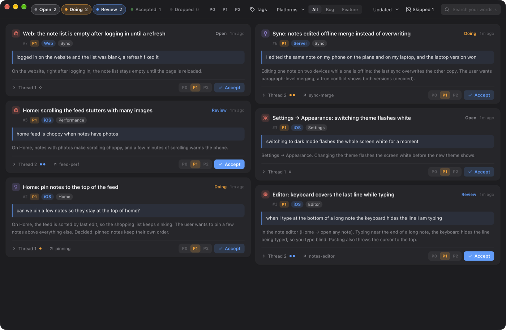
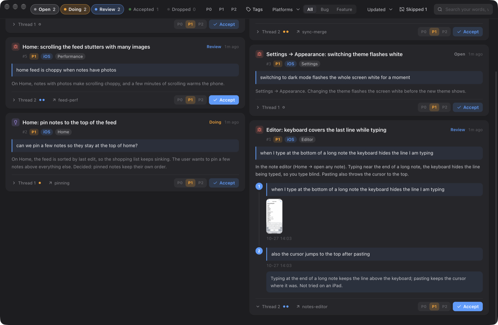

# Mana Tracker

**English** · [中文](README.zh-CN.md)

A requirement & bug list that your coding agents keep for you.

You talk to Claude Code or Codex the way you already do — "the save button does nothing", "also
make the header sticky", "still broken". The agent records every bug and requirement you raise,
keeps it current while it works, and hands it back when it's done. You verify in a small Mac app
and click **Accept** — or just tell the agent "accept #12" in the conversation.



## Why

When you work with coding agents all day, requests scatter across dozens of conversations. A
week later nobody knows which ones were done, which were verified, and which were quietly
forgotten. Mana Tracker makes the agent account for **every message you send**:

- **Nothing slips through.** A hook checks each turn: your message was either recorded, or the
  agent said why it isn't a requirement (`skip "reason"`) — and those reasons are listed in the
  app for you to spot-check.
- **Your words, not the agent's summary.** Each item keeps what you actually said, the screenshots
  you pasted, and a short background written for you-a-week-later.
- **You sign off, not the agent.** Agents hand work over for review; only you accept it. If you
  accept in the conversation, the CLI checks your exact words against the session transcript.
- **One click back to the conversation.** Every item remembers the session that worked on it;
  the app reopens it (in cmux if you use it, otherwise in Terminal).

## How it fits together

```
you ──talk──► Claude Code / Codex ──mana-track──► <project>/.mana-tracker/items/*.json ◄──watch── Mana Tracker app ◄── you verify
                     ▲                                                                                  │
                     └──────────────── hooks: every turn is recorded or skipped ─────────── reopen ─────┘
```

| Part | What it does |
|---|---|
| `cli/mana-track` | The only writer of the list. Python 3, no dependencies. |
| `skills/mana-tracker` | Teaches the agent when to record, how to split one message into items and points, and how to write titles and context. |
| `hooks/hook.py` | Claude Code / Codex hooks: shows open items at session start, blocks the turn if your message went unaccounted for, refuses direct edits to the data. |
| `app/` | The Mac app (Electron) where you review, accept, set priority and jump back into conversations. |

## Install

Requirements: macOS, Python 3, Claude Code and/or Codex. Building the app needs Node 22+ and pnpm.

```bash
git clone https://github.com/mana-am/agent-tracker.git
cd agent-tracker
./install.sh --app      # CLI + skill + hooks + app (drop --app to skip the app)
```

`install.sh` links `mana-track` into `~/.local/bin`, links the skill into `~/.claude/skills` and
`~/.agents/skills`, adds the hooks to `~/.claude/settings.json` and `~/.codex/hooks.json` (keeping
a `.bak-mana-tracker` copy), and builds the app into `/Applications`. It is safe to re-run.

**Codex:** hooks must be switched on — add `hooks = true` under `[features]` in
`~/.codex/config.toml`. Codex asks you to trust new hooks the first time.

The hooks are installed at user level but only act inside projects you set up, so other work is
untouched.

## With cmux (recommended)

[cmux](https://github.com/manaflow-ai/cmux) is a macOS terminal built for running many coding-agent
sessions side by side, each in its own named workspace. Mana Tracker works without it, but the two
fit together:

- **Every item remembers its workspace.** When the agent records or updates an item inside cmux,
  the workspace's id and name are saved with it, and the card shows that name.
- **Open conversation jumps straight there.** If the workspace is still open, the app switches cmux
  to it. If you closed it, the app opens a new workspace that resumes the same Claude Code / Codex
  session, with the same launch command it was started with.
- **Search finds items by workspace name**, including names you gave the workspace later.

Without cmux, **Open conversation** opens a Terminal window in the directory the agent worked in
and resumes the session there (`claude --resume …` / `codex resume …`).

## Tutorial

### 1. Set up a project

Open Claude Code or Codex in your project's root and say:

> set up the tracker here

The agent reads the repository and decides the settings itself: the product's name, its
platforms (which directories are the iOS app, the web app, the server…), the directories to
ignore (scratch areas, generated code), a one-line scope, and a handful of starting tags. Then it
tells you what it chose. To change something later, just say so ("treat workers as part of the
server", "ignore the playground folder").

Prefer to do it by hand? It is one command:

```bash
mana-track init --name "Pocket Notes" \
    --platform iOS=ios --platform Web=web --platform Server=server,workers \
    --exclude playground
```

| Option | Meaning |
|---|---|
| `--platform NAME=DIR[,DIR]` | Which part of the product each directory is. An item gets the platform of the directory the agent works in, and the app filters by it. Optional. |
| `--exclude DIR` | Sessions under it are out of scope. Optional. |
| `--scope "…"` | One line telling the agent what counts. Default: product bugs and requirements, not marketing, data lookups or agent tooling. |
| `--commit` | Version the list with git. By default it stays on this machine. |

Run `init` again with new options to change the settings; it keeps the rest.

### 2. Work as usual

Open Claude Code or Codex anywhere inside the project and talk normally:

> the keyboard covers the last line when I type at the bottom of a long note, and pasting jumps the cursor to the top

The agent creates **one item with two points** (same screen, verified together), with your words,
a background paragraph and a tag, then starts working:

```
#1 created: Editor: keyboard covers the last line while typing
```

Several messages about the same thing become points on one item; unrelated problems in one
message become separate items. The skill has the full rules and examples.

### 3. Review

When the agent finishes, it hands the item over with a plain note: what changed, how to check it,
and what it did **not** verify. The card turns to **Review** and the Dock badge counts how many
are waiting.

Expand **Thread** on a card to see every point you raised, the screenshots you pasted, and the agent's note on what changed:



- **It works** → click **Accept** in the app, or tell the agent "accept #1".
- **Still wrong** → tell the agent ("still covers it in landscape"). Your words become a new point
  and the old one goes back to Doing.
- **Not wanted anymore** → tell the agent ("forget that"). It drops the points, quoting you.

### 4. In the app

- **Status chips** (multi-select) — Open / Doing / Review / Accepted / Dropped.
- **P0 / P1 / P2** — only you set priority; every item starts at P1.
- **Tags, platforms, type, sort** — filters stack with search.
- **Search** — matches only your own words and the workspace names, not the agent's summaries.
- **Thread** — every point you raised, with screenshots and the agent's notes.
- **Open conversation** — jumps back into the session that worked on it.
- **Double-click a title** to rename it; the agent can no longer change it.
- **Skipped N** — turns the agent judged "not a requirement", with its reasons.

### 5. Commands

Agents run these; you rarely need to.

```bash
mana-track list [--all] [--status review doing]
mana-track show 12
mana-track new --type bug|feature --title "Screen: symptom" --point "your words" [--point …] \
    --tag Editor --context "background" [--platform iOS] [--with-images]
mana-track point 12 "follow-up" [--with-images]
mana-track start 12 [-p 2]
mana-track review 12 --note "what changed, how to check, what wasn't verified" [--file path]
mana-track accept 12 --quote "the user's exact words"     # verified against the transcript
mana-track drop 12 -p 3 --quote "the user's exact words"
mana-track merge 28 29 30            # fold over-split items; old ids redirect
mana-track tags | tag-new | tag-merge | tag-drop
mana-track skip "why this turn had no requirement"
mana-track init | remove | uninstall
```

## Data

Everything lives in `<project>/.mana-tracker/`:

```
config.json        name, scope, platforms, exclude
items/0001.json    one file per item: title, context, points, sessions, log
attachments/       screenshots, per item
tags.json          the project's tags
skips.jsonl        every "not a requirement" turn, with the reason
```

Plain JSON, written atomically under a file lock, so several agents can work at once. The app
watches the folder and updates live.

## Limits

- The app is macOS only. The CLI and hooks run anywhere Python 3 does, but the transcript features
  (attaching pasted images, checking an accept quote) read Claude Code's and Codex's local session
  files.
- The hook makes the agent account for every message; it cannot judge whether the agent's call was
  right. That is what the Skipped list is for.
- Reopening a conversation needs Claude Code / Codex sessions that still exist on this machine.

## Uninstall

You can ask the agent ("stop using the tracker in this project", "uninstall the tracker"), or run
the commands yourself:

```bash
mana-track remove                  # this project only: stop tracking, keep the list aside
mana-track remove --delete-data    # this project only: also delete the list for good
mana-track uninstall               # this machine: hooks, skill and CLI (every project); lists stay
mana-track uninstall --app         # …and delete the app too
```

`remove` moves the list to `.mana-tracker.removed-<date>`; rename it back and run `init` to
restore. `./uninstall.sh` in the repository does the same as `mana-track uninstall`.

## License

[MIT](LICENSE)
