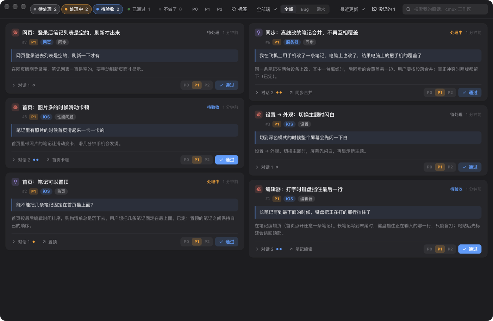
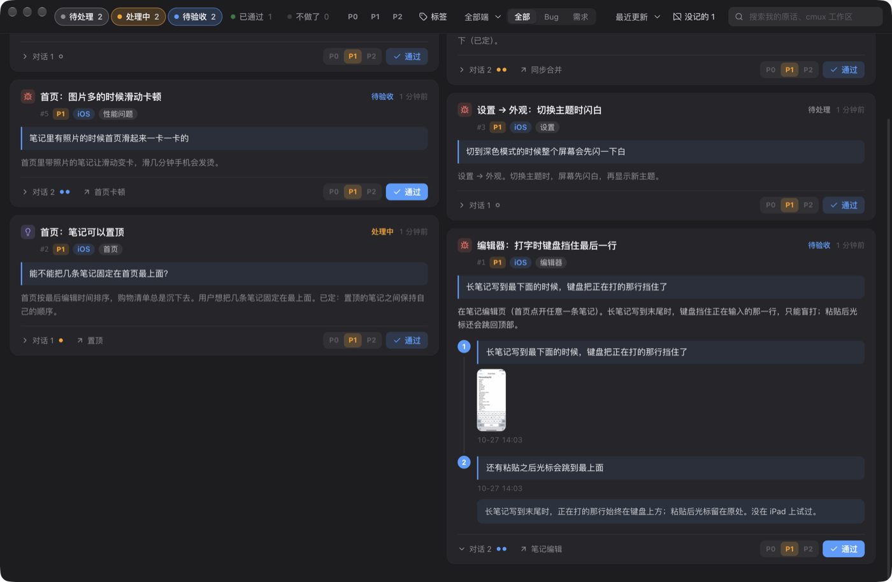

# Mana Tracker

[English](README.md) · **中文**

一份由 coding agent 替你维护的需求和 bug 清单。

你照常跟 Claude Code 或 Codex 说话：「保存按钮没反应」「顶栏也固定住」「还是不行」。agent 会把你提的每个
bug 和需求记下来，干活时随时更新，做完交回给你验。你在一个小小的 Mac 应用里看效果、点「通过」，也可以直接在
对话里说「#12 通过」。



## 为什么要它

整天和 coding agent 一起干活，需求会散落在几十个对话里。过一周，没人说得清哪些做完了、哪些验过了、哪些被悄悄
忘了。Mana Tracker 让 agent 对**你发的每一条消息**都有交代：

- **一条都不会漏。** 每一轮都有 hook 检查：你说的话要么记进了清单，要么 agent 说明了为什么不算需求
  （`skip "原因"`）。这些原因会列在应用里，供你抽查。
- **留的是你的原话。** 每一条都保存你当时怎么说的、贴的截图，以及一段写给「一周后的你」的背景。
- **通过是你签字。** agent 只能把做完的活交给你验收，通过只能由你来点。你在对话里说通过，命令行会拿你的原话
  去对话记录里核对。
- **一键回到那段对话。** 每一条都记得是哪个会话在处理它，应用能直接打开那个会话（装了
  cmux 就在 cmux 里打开，没装就开一个终端窗口）。

## 由哪几部分组成

```
你 ──说话──► Claude Code / Codex ──mana-track──► <项目>/.mana-tracker/items/*.json ◄──监听── Mana Tracker 应用 ◄── 你验收
                    ▲                                                                                │
                    └─────────────── hook：每一轮要么记下、要么说明不记 ─────────────── 回到对话 ─────┘
```

| 部分 | 作用 |
|---|---|
| `cli/mana-track` | 清单唯一的写入口。Python 3，没有依赖。 |
| `skills/mana-tracker` | 教 agent 什么时候记、一条消息怎么拆成几条几个点、标题和背景怎么写。 |
| `hooks/hook.py` | Claude Code / Codex 的 hook：开会话时列出没做完的条目；你的话没交代就拦下这一轮；不许直接改数据文件。 |
| `app/` | Mac 应用（Electron）：看清单、点通过、改优先级、跳回对话。 |

## 安装

需要：macOS、Python 3、Claude Code 或 Codex。编译应用还需要 Node 22+ 和 pnpm。

```bash
git clone https://github.com/mana-am/agent-tracker.git
cd agent-tracker
./install.sh --app      # 命令行 + skill + hook + 应用（不加 --app 就不装应用）
```

`install.sh` 会做这几件事：

- 把 `mana-track` 链接到 `~/.local/bin`；
- 把 skill 链接到 `~/.claude/skills` 和 `~/.agents/skills`；
- 把 hook 加进 `~/.claude/settings.json` 和 `~/.codex/hooks.json`，原文件先备份成 `.bak-mana-tracker`；
- 把应用编译好放进 `/Applications`。

重复运行也没关系。

**Codex：** 要先打开 hook 功能，在 `~/.codex/config.toml` 的 `[features]` 下面加一行 `hooks = true`。
第一次运行时 Codex 会让你确认是否信任新的 hook。

hook 装在用户级别，但只在你初始化过的项目里起作用，不影响别的工作。

## 配合 cmux 使用（推荐）

[cmux](https://github.com/manaflow-ai/cmux) 是一个 macOS 终端，专门用来同时跑很多个 coding agent 会话，
每个会话在自己有名字的工作区里。不装 cmux 也能用 Mana Tracker，但两者配合起来最顺手：

- **每一条都记得自己的工作区。** agent 在 cmux 里记录或更新条目时，会把当前工作区的编号和名字一起存下来，
  卡片上就显示这个名字。
- **「打开对话」直接跳过去。** 工作区还开着，应用就把 cmux 切到那个工作区；已经关掉了，应用会新开一个工作区，
  用当初启动它的同一条命令，接着原来的 Claude Code / Codex 会话往下聊。
- **能按工作区名字搜到条目**，你后来给工作区改的名字也能搜。

没装 cmux 时，「打开对话」会在 agent 当时干活的目录里开一个终端窗口，接着那个会话聊
（`claude --resume …` / `codex resume …`）。

## 使用教程

### 1. 初始化项目

在项目根目录打开 Claude Code 或 Codex，说一句：

> 初始化 tracker

agent 会先读一遍仓库，自己定好设置：产品叫什么、分哪几端（哪个目录是 iOS、哪个是网页、哪个是服务器……）、
哪些目录不用管（草稿区、生成的代码）、一句话的记录范围，再建几个常用标签。定完会告诉你它是怎么定的。以后想改，
直接跟它说就行（「workers 也算服务器」「playground 目录别管」）。

想自己动手也行，就一条命令：

```bash
mana-track init --name "口袋笔记" \
    --platform iOS=ios --platform 网页=web --platform 服务器=server,workers \
    --exclude playground
```

| 参数 | 意思 |
|---|---|
| `--platform 名字=目录[,目录]` | 每个目录属于产品的哪一端。agent 在哪个目录干活，新条目就标哪一端，应用里可以按端筛选。可不填。 |
| `--exclude 目录` | 这个目录下的会话不算。可不填。 |
| `--scope "……"` | 用一句话告诉 agent 什么算需求。默认是产品的 bug 和需求，不包括营销、查数据、给 agent 用的工具。 |
| `--commit` | 清单跟着代码一起进 git。默认只留在本机。 |

想改设置，带上新参数再运行一次 `init`，没提到的设置保持不变。

### 2. 照常干活

在项目里任何一个目录打开 Claude Code 或 Codex，正常说话：

> 长笔记写到最下面的时候，键盘把正在打的那行挡住了，还有粘贴之后光标会跳到最上面

agent 会建**一条、两个点**（同一个界面，会一起验），带上你的原话、一段背景和一个标签，然后开始干活：

```
#1 created: 编辑器：打字时键盘挡住最后一行
```

连着几条消息说的是同一件事，就合成一条的几个点；一句话里说了几件不相干的事，就拆成几条。完整规则和例子都在
skill 里。

### 3. 验收

agent 做完后，会附一段大白话说明交给你：改了什么、怎么验、哪些**没有**验证过。卡片变成「待验收」，程序坞图标上
的数字是等你验收的条数。

展开卡片上的「对话」，能看到你提过的每一个点、贴过的截图，以及 agent 写的改动说明：



- **没问题** → 在应用里点「通过」，或者跟 agent 说「#1 通过」。
- **还不对** → 直接跟 agent 说（「横屏的时候还是挡住」）。你的话会变成一个新的点，原来那个点退回「处理中」。
- **不要了** → 跟 agent 说（「这个不做了」）。它会引用你的原话，把这些点标成「不做了」。

### 4. 应用里能做什么

- **状态胶囊**（可多选）：待处理 / 处理中 / 待验收 / 已通过 / 不做了。
- **P0 / P1 / P2**：优先级只有你能改，新条目一律是 P1。
- **标签、端、类型、排序**：这些筛选和搜索叠加生效。
- **搜索**：只搜你自己说过的话和工作区名，不搜 agent 写的总结。
- **对话**：展开能看到你提过的每一个点，连同截图和 agent 的说明。
- **打开对话**：跳回处理这一条的那个会话。
- **双击标题**可以改名，改过之后 agent 就不能再动这个标题。
- **备注**：卡片底部点「备注」写几句。点到别处或 ⌘↩ 保存，Esc 放弃，清空就是删除。agent 用 `mana-track show` 能看到；写备注不会打乱排序。
- **标记**：点卡片空白处加黄框，再点一次取消；顶栏「取消全部标记」一次清掉。用来一次性过一遍所有条目。按项目分别存在应用里，重启还在。
- **没记的 N**：agent 判成「不是需求」的那些轮，带着它的理由。

### 5. 命令速查

这些命令是给 agent 用的，你一般用不到。

```bash
mana-track list [--all] [--status review doing]
mana-track show 12
mana-track new --type bug|feature --title "界面：现象" --point "用户原话" [--point …] \
    --tag 编辑器 --context "背景" [--platform iOS] [--with-images]
mana-track point 12 "追问" [--with-images]
mana-track start 12 [-p 2]
mana-track review 12 --note "改了什么、怎么验、哪些没验证" [--file 路径]
mana-track accept 12 --quote "用户原话"      # 会去对话记录里核对
mana-track drop 12 -p 3 --quote "用户原话"
mana-track merge 28 29 30            # 拆细了就合；旧编号自动转到新的
mana-track tags | tag-new | tag-merge | tag-drop
mana-track skip "这一轮为什么没有需求"
mana-track init | remove | uninstall
```

## 数据

所有东西都在 `<项目>/.mana-tracker/` 里：

```
config.json        名字、范围、端、排除的目录
items/0001.json    一条一个文件：标题、背景、各个点、会话、记录
attachments/       截图，按条目分文件夹
tags.json          这个项目的标签
skips.jsonl        每一次「不是需求」和它的理由
```

都是普通 JSON，加文件锁、原子写入，几个 agent 同时干活也不会写坏。应用监听这个文件夹，实时刷新。

## 已知限制

- 应用只支持 macOS。命令行和 hook 在有 Python 3 的地方都能跑，但挂截图、核对通过原话这两件事要读
  Claude Code 和 Codex 存在本机的对话记录。
- hook 只能保证 agent 每一轮都有交代，判不了 agent 判得对不对。所以才有「没记的」那张清单给你抽查。
- 「打开对话」要求那个 Claude Code / Codex 会话还在这台电脑上。

## 卸载

可以直接跟 agent 说（「这个项目不用 tracker 了」「卸载 tracker」），也可以自己运行：

```bash
mana-track remove                  # 只针对当前项目：不再记录，清单挪到一边保留
mana-track remove --delete-data    # 只针对当前项目：连清单一起彻底删掉
mana-track uninstall               # 整台电脑：删掉 hook、skill 和命令行（所有项目都停用），清单保留
mana-track uninstall --app         # ……连应用一起删
```

`remove` 会把清单挪到 `.mana-tracker.removed-<日期>`，改回 `.mana-tracker` 再运行一次 `init` 就能恢复。
仓库里的 `./uninstall.sh` 和 `mana-track uninstall` 是一样的。

## 许可证

[MIT](LICENSE)
